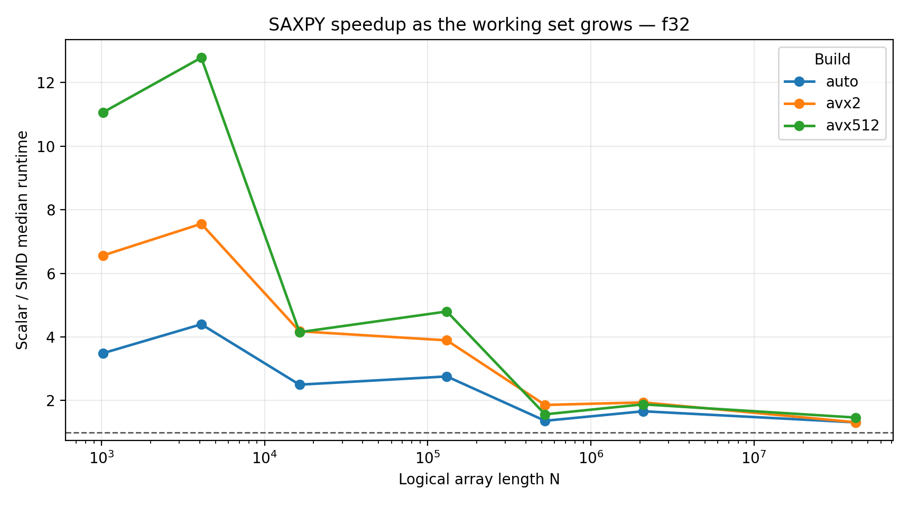
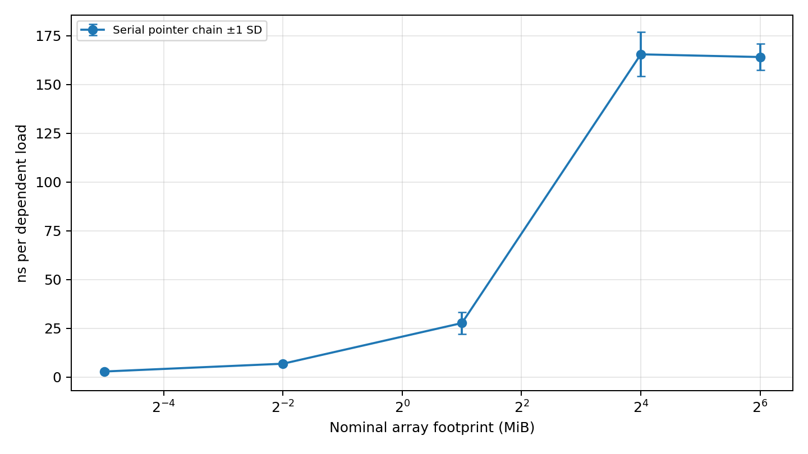
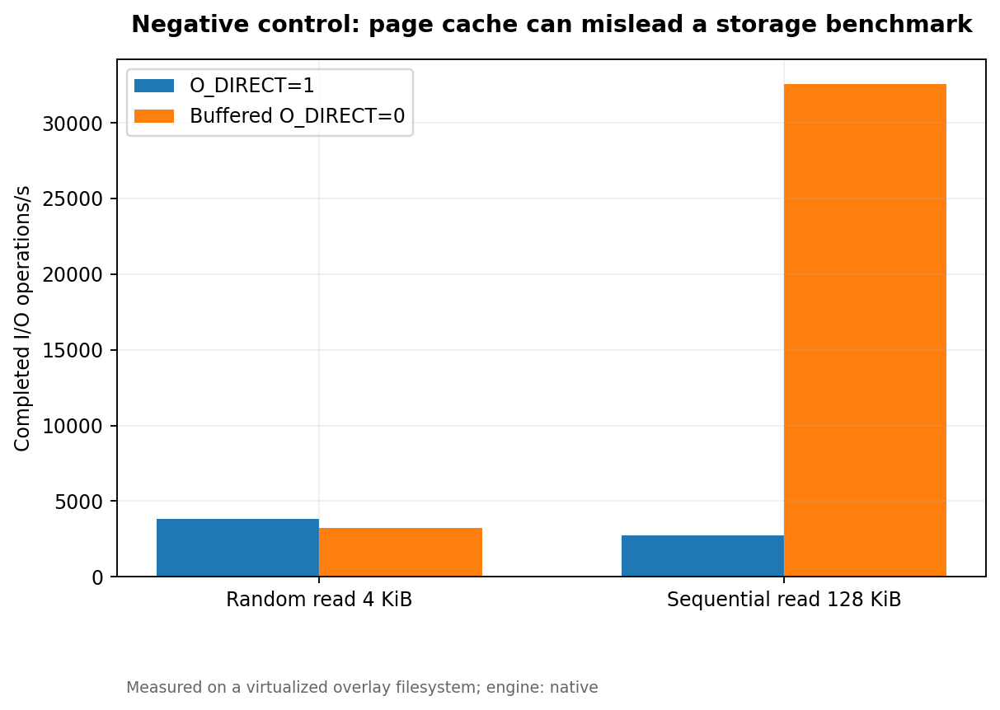

# Advanced Computer Systems — Performance Profiling Projects

**ECSE 6320 | Class-wide Projects | October 2026**

This repository brings together three experimental studies of computer-system performance, from CPU vector execution to the memory hierarchy and storage I/O. The central goal is to explain *why* performance changes as the workload changes—not simply to report the highest speedup or throughput number. Each project includes benchmark implementations, repeatable experiment scripts, original measurement records, processed results, figures, and a technical report.

The studies use measurements from a **virtualized Linux development environment**. Hardware-specific limitations, unavailable counters, and experiments that could not be performed are documented alongside the results.

## Projects at a glance

| Project | What was investigated | Recorded evidence | Technical report |
|:--|:--|:--|:--|
| **[01 · SIMD Advantage Profiling](project1-simd-profiling/)** | Scalar vs. compiler-vectorized code; AVX2/AVX-512; cache locality; alignment, tails, strides, and data types | 1,320 timing samples · 440 configurations · 9 figures | [PDF](project1-simd-profiling/report/SIMD_Advantage_Profiling_Report.pdf) · [Analysis](project1-simd-profiling/report/methodology-and-analysis.md) |
| **[02 · Cache & Memory Performance](project2-cache-memory/)** | Dependent-load latency; sequential/random locality; strides; read/write mixes; memory-level parallelism | 585 timing samples · 195 configurations · 5 figures | [PDF](project2-cache-memory/report/Cache_Memory_Performance_Report.pdf) · [Analysis](project2-cache-memory/report/Cache_Memory_Performance_Report.md) |
| **[03 · SSD Performance Profiling](project3-ssd-profiling/)** | File-backed direct I/O; block size; random/sequential requests; read/write mixes; concurrency and tail latency | 118 timing samples · 59 configurations · 9 figures | [PDF](project3-ssd-profiling/report/SSD_Performance_Profiling_Report.pdf) · [Analysis](project3-ssd-profiling/report/SSD_Performance_Profiling_Report.md) |

## Selected findings

### 01 · SIMD: wider vectors are not universally faster

The first project implements **SAXPY, dot product, and elementwise multiplication** in 32-bit and 64-bit floating point. It compares a scalar build, ordinary compiler auto-vectorization, AVX2, and AVX-512. Correctness is checked against reference computations, while compiler reports and disassembly provide evidence of actual vectorization.

For float32 SAXPY with 4,096 elements, the recorded AVX-512 speedup over scalar was **12.79×**. With 41,943,040 elements, the corresponding speedup was **1.47×**. The shrinking gain is consistent with memory-system limits becoming more important than arithmetic instruction throughput. A separate stride experiment showed another failure mode: the compiler vectorized the contiguous SAXPY path but did not vectorize its non-unit-stride path.



### 02 · Memory: latency and throughput describe different behavior

The second project uses dependent pointer chasing to suppress overlap between loads, then introduces independent pointer chains to explore memory-level parallelism. It also examines access order, granularity, read/write ratios, and page-locality advice.

Random single-chain latency increased from **2.53 ns/access at 32 KiB** to **224.02 ns/access at 512 MiB**. Eight independent chains at 512 MiB achieved **25.81 ns per completed access in aggregate**; this is a throughput measure, *not* the intrinsic latency of one load. The report uses **Little's Law** to interpret overlapping work and an **AMAT-style model** to explain why elapsed timing alone cannot identify cache miss rates.

An important negative case concerns cache residency: **64 MiB is smaller than the reported 260 MiB shared last-level cache**, so a 64 MiB experiment cannot automatically be described as DRAM-resident. A separate 512 MiB run was included to examine a nominal footprint beyond that reported capacity.



### 03 · Storage: page-cache effects can dominate a benchmark

The third project measures an aligned, regular-file I/O workload using a native Linux synchronous `pread`/`pwrite` engine with configurable access patterns, block sizes, request mixes, and worker concurrency. It retains per-I/O latency distributions, including high-percentile tails, and uses **Little's Law** to check throughput/latency consistency.

A controlled negative example recorded about **4,070 MiB/s** for buffered 128 KiB sequential reads but about **345 MiB/s** with `O_DIRECT` on the same virtualized file path—a difference of approximately **11.8×**. The buffered figure must not be presented as physical SSD throughput. Random 4 KiB read throughput increased from **3,412 IOPS with one synchronous worker** to **41,486 IOPS with 32 workers**, without a confirmed saturation knee in that tested range.

The repository contains FIO job definitions and an FIO runner, but **genuine Flexible I/O Tester measurements were not produced** in this environment. Native worker concurrency is not labeled as hardware NVMe queue depth, and the underlying physical SSD could not be identified.



## How the repository is organized

```text
.
├── README.md
├── project1-simd-profiling/
│   ├── src/                 Numerical kernels and timing harness
│   ├── scripts/             Runs, parsers, vector verification, plots
│   ├── data/raw/            Original measurements and environment record
│   ├── data/processed/      Statistical summaries and matched speedups
│   ├── build/reports/       Compiler vectorization evidence
│   ├── plots/               Performance figures
│   └── report/              PDF and Markdown technical reports
├── project2-cache-memory/
│   ├── src/                 Pointer-chasing and memory-access kernels
│   ├── scripts/             Test, experiment, analysis, and plotting tools
│   ├── data/raw/            Timestamped measurement records
│   ├── data/processed/      Aggregated results
│   ├── evidence/            Environment metadata
│   ├── plots/               Locality, stride, mix, and MLP figures
│   └── report/              PDF and Markdown technical reports
└── project3-ssd-profiling/
    ├── src/                 Native regular-file I/O benchmark
    ├── jobs/                FIO job specifications
    ├── scripts/             Safety checks, runners, parsers, and plots
    ├── data/raw/            Per-trial JSON and run manifests
    ├── data/processed/      Statistical results and analysis metadata
    ├── evidence/            Environment and validation records
    ├── plots/               IOPS, latency, tail, and pitfall figures
    └── report/              PDF and Markdown technical reports
```

Each project has its own README ([Project 1](project1-simd-profiling/README.md), [Project 2](project2-cache-memory/README.md), [Project 3](project3-ssd-profiling/README.md)) covering configuration, execution, correctness, and interpretation. Results and plots are retained with their underlying data rather than being presented as isolated screenshots.

## Reproducing the analysis

The code targets **Linux/x86-64**, with GCC, GNU Make, Python 3, and the Python packages identified by the individual projects. Project 1 additionally requires CPU support for the ISA variant being executed; Project 3 requires a filesystem supporting the requested direct-I/O constraints. Commands below operate on the included measurements and source trees, rather than implying they recreate the exact timing values on another machine.

```bash
# Project 1: build, validate, summarize and plot
cd project1-simd-profiling
make all && make test && make summarize && make plot

# Project 2: build, validate, summarize and plot
cd ../project2-cache-memory
make all && make test && make summarize && make plot

# Project 3: build, validate, analyze and plot
cd ../project3-ssd-profiling
make all && make test && make analyze && make plot
```

Fresh measurement campaigns, platform-specific options, and storage safety controls are explained in each project's README. Running a new benchmark creates a new experimental observation; different hardware, CPU placement, virtualization settings, device caching, and system load can change the results substantially.

## Experimental standards and limitations

Across all three studies, the analysis distinguishes **measured quantities from derived estimates**: elapsed time from core cycles; useful-byte throughput from physical memory traffic; aggregate operations per second from individual request latency; and synchronous-worker count from storage-device queue depth. The original data, parameters, repetitions, and experimental environment are retained to make these distinctions auditable.

| Study | Recorded platform and principal limitation |
|:--|:--|
| SIMD | Virtualized Intel Xeon Platinum 8573C, GCC 14.2.0; single-core pinned campaign. Hardware unhalted-core-cycle counters unavailable. |
| Cache/memory | Virtualized Intel Xeon Platinum 8573C; unpinned campaign. Cache/TLB PMU counts and confirmed huge-page allocations unavailable. |
| Storage | KVM/overlayfs-backed regular file, not a directly characterized physical NVMe SSD. Native synchronous I/O measured; FIO jobs supplied but not executed. |

The numerical findings apply to these recorded environments. In particular, the SSD observations do **not** establish the maximum throughput or latency distribution of a known physical SSD, and timing-only cache results do **not** establish precise hit or miss rates. Unexpected behavior and unsuccessful assumptions are included in the reports rather than excluded from the discussion.

## AI assistance and academic responsibility

**OpenAI ChatGPT** was used to assist with benchmark code, shell/Python automation, correctness tests, data processing, plots, and report drafting. The reported figures and tables derive from retained executions in the development environment, with hardware and tooling limitations disclosed.

