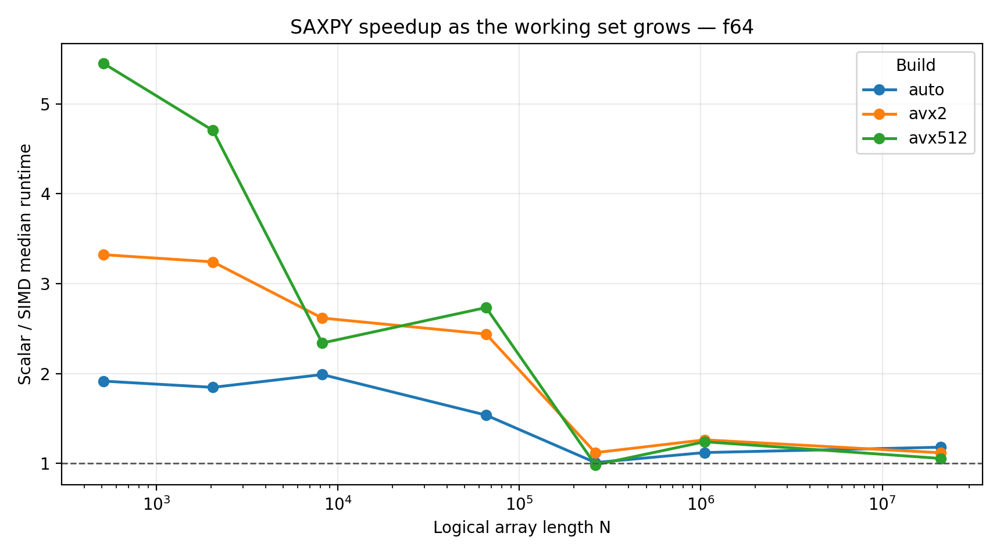
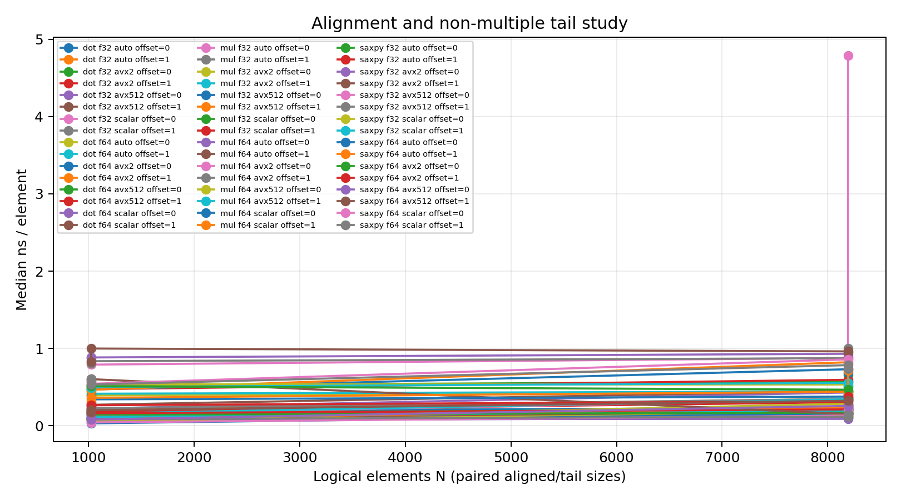
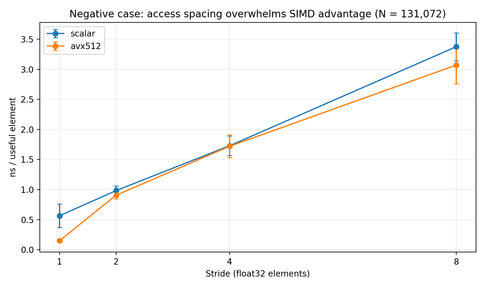
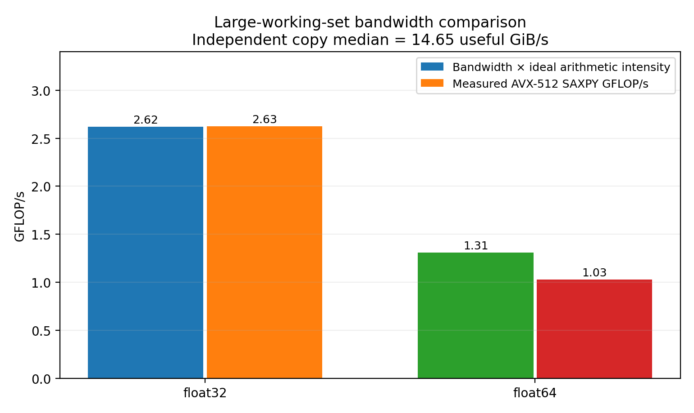

# Measurement report — Project 1: SIMD Advantage Profiling

**ECSE 4320/6320 | October 24, 2026**  
**Scope:** single pinned CPU; SAXPY, dot product, elementwise multiplication; binary32/binary64; four compiler/ISA builds; matched alignment/tail/stride cases.

## 1. Experimental question and prior expectations

The question is whether compiler-generated packed arithmetic translates into useful speedup, and where working-set size or access layout makes the SIMD width less relevant. Before examining measurements, the predicted trends were: (i) contiguous loops gain from SSE/AVX2/AVX-512, but speedup is not proportional to SIMD lane count; (ii) the advantage compresses as a working set spills from close caches toward shared LLC and memory; (iii) pointer shifts or remainders add code paths with possible but non-universal cost; (iv) strided access reduces cache-line utility and sometimes blocks vectorization; (v) binary64 halves lanes and doubles the working-set bytes at fixed N.

The kernels are intentionally simple enough to examine in object code. They also expose different bottlenecks: SAXPY has read-modify-write state, dot has an accumulation dependency and an output scalar, and multiplication is an independent three-array stream.

## 2. Machine, controls and provenance

| Item | Observed specification |
|---|---|
| Run date | October 24, 2026 (UTC metadata in `data/raw/environment.txt`) |
| Machine | Virtualized Intel Xeon Platinum 8573C (KVM guest) |
| Visible CPUs / placement | Five logical CPUs visible; **CPU 0** pinned with `taskset`, one benchmark process and one thread |
| Cache reported to guest | L1D 48 KiB/private instance, L2 2 MiB/private instance, aggregate L3 260 MiB |
| SMT | Reported inactive (`0` in Linux SMT status) |
| OS / kernel | Linux 6.18.55, x86-64 |
| Compiler | GCC 14.2.0, C11, `-O3` |
| ISA builds | `scalar` no tree/SLP vectorization; `auto` portable x86-64/SSE-class; `avx2` `-mavx2 -mfma`; `avx512` `-mavx512f -mfma` |
| FP policy | Identical across all builds: reassociation enabled, `-ffp-contract=off`; all comparisons use the same declared numerical tolerance |
| Timebase | `CLOCK_MONOTONIC_RAW`, grouped kernel-call batches; independent RDTSC reference ticks also reported |
| Samples | 1,320 raw timings, 440 configurations; **three repeats per configuration** |
| CPU frequency/governor | Not exposed by guest sysfs; no direct guarantee of fixed operating frequency |
| Hardware core cycles | Linux `perf_event_open` unavailable; `core_cycles_per_element` blank, not backfilled with TSC |
| Independent bandwidth | Seven pinned libc-copy trials, 192 MiB source + 192 MiB destination |

**Method and sequence.** The first measured matrix used `REPS=3 TARGET_MS=6 bash scripts/run_recorded_campaign.sh`; its six per-precision locality sizes ranged from 512/1,024 to 1,048,576/2,097,152 useful elements. The same campaign exercised all six kernel/precision combinations for offsets 0/1 at N=1024/1025/8192/8193 and stride 1/2/4/8 at N=131072. An additional larger contiguous SAXPY size was appended for every ISA at N=41,943,040 (f32) and N=20,971,520 (f64), each with three independent timed batches and reference validation. Both large cases have two active buffers totaling **320 MiB** and allocate three buffers totaling **480 MiB**; these footprints exceed the nominal aggregate L3, although an LLC miss count was not available. The write-producing loops were reset *outside* measured intervals, and output checksums were consumed *after* timed intervals. Distinct input arrays were never aliased.

`data/raw/measurements.csv` is the unmodified primary timing evidence. `data/raw/environment.txt` records the system report and exact build-flag policy; `data/raw/memcpy_bandwidth.csv` contains the independent copy observations; `data/raw/validation.log` retains parser/unit and sanitizer runs. `build/reports/*-vectorization.txt` and `build/reports/isa-summary.txt` contain compiler and object-code evidence. Processed summaries were made with `scripts/parse_perf.py`; plots were computed from the processed files, not generated from hypothetical numbers.

**Caveats affecting inference.** The virtual CPU has no accessible fixed-frequency control or unhalted-core-cycle PMU; real core cycles/element cannot be calculated. Reference TSC ticks averaged approximately 2.30 ticks/ns in these samples; that ratio reflects a reference counter and must **not** be relabeled as instantaneous CPU-core frequency. CPU 0 affinity reduces scheduling migration but does not isolate the guest from the hypervisor or other users. Reported L3 size is a host-provided value, not measured exclusive LLC. The preheated repeated-call protocol is useful for throughput comparison but intentionally does not measure cold-cache latency.

## 3. Correctness and instruction evidence

All 1,320 timing records have status **PASS**, and every recorded `validation_max_abs_error` is 0 for the chosen deterministic, binary-exact fractional input patterns. That does not prove bitwise equality for arbitrary inputs: the compiler flags permit reduction reassociation, and the numerical reference separately allows an extended-precision bound for dot. The regression test suite passed, including offsets, stride 8, odd tails and very small N. A combined AddressSanitizer/UndefinedBehaviorSanitizer validation also passed; its terminal output is in `data/raw/validation.log`.

The compiler report from the actual **AVX-512 build** identifies the contiguous SAXPY f32 loop at `src/kernels.c:4` as using **64-byte and 32-byte vectors**. Its f64 analogue at line 16 likewise has 64-byte/32-byte vector versions. GCC reports the f32 strided SAXPY loop at line 8 as **“missed: couldn't vectorize loop”**, with no usable vector type for the scalar load at line 10. The AVX2 report identifies 32-byte and 16-byte contiguous loops at the same source positions. The scalar build disables both loop and SLP vectorization and shows scalar `mulss`/`mulsd`, not packed `mulps`/`mulpd`. The object-level audit includes, for example, AVX-512 `vmulps` and `vaddps` with `zmm` operands in contiguous SAXPY, and AVX2 `vmulps`/`vaddps` with `ymm` operands. Dot uses packed adds and horizontal reduction code; shorter vectors also appear in its tail and reduction stages. Presence of a register name in a whole-function dump alone is not treated as proof that every branch used packed SIMD, and `-ffp-contract=off` precludes crediting fused FMA throughput.

## 4. Main comparison: locality and SIMD width

The table gives per-element median wall time for SAXPY. All times are **nanoseconds**, not cycles. Each small-N point and each large-N point has three repeats; fluctuations are preserved in `summary.csv`.

| Precision / N | Scalar | Auto | AVX2 | AVX-512 | AVX-512 / scalar speedup |
|---|---:|---:|---:|---:|---:|
| f32 / 4,096 | 0.625 | 0.142 | 0.083 | 0.049 | 12.79× |
| f32 / 524,288 | 0.666 | 0.488 | 0.358 | 0.425 | 1.57× |
| f32 / 41,943,040 | 1.116 | 0.849 | 0.847 | 0.762 | 1.47× |
| f64 / 2,048 | 0.506 | 0.274 | 0.156 | 0.108 | 4.70× |
| f64 / 262,144 | 0.909 | 0.901 | 0.812 | 0.924 | 0.98× |
| f64 / 20,971,520 | 2.053 | 1.739 | 1.835 | 1.945 | 1.06× |

The data distinguish execution width from achieved time. For f32 SAXPY at 4,096, AVX-512 reached 40.90 GFLOP/s versus 3.20 GFLOP/s scalar, an impressive cache-resident improvement. At the 320 MiB active large-array case, the AVX-512 result fell to **2.626 GFLOP/s**, while the scalar counterpart achieved **1.792 GFLOP/s**. Thus the speedup compressed markedly rather than tracking the 16-lane versus scalar ratio. Binary64 compressed even more: 4.70× at N=2,048, then only 1.06× for the largest size. This is consistent with memory traffic becoming much more important, but it is not proof of a specific miss-rate threshold without cache/IMC PMU events.

*Figure 1. Measured f32 SAXPY speedup. Values above one favor the selected SIMD build; later convergence is visible as the working set grows.*

*Figure 2. Measured f64 SAXPY speedup. The largest size shows little residual AVX-512 advantage.*

The dot product similarly benefited from SIMD in its small N cases, but required a tree/reduction of partial sums and compiler reassociation, not just the normal unit-stride load pattern. For f32 at N=4,096, dot obtained **8.34×** AVX2 and **9.39×** AVX-512 speedup; at N=2,097,152 those gains were **2.01×** and **2.49×**. For f64 at N=2,048, dot gave **4.04×** AVX2 and **5.34×** AVX-512; at N=1,048,576 they reduced to **1.20×** and **1.23×**. Elementwise multiply exhibits the same broad compression, with extra sensitivity to its third active array and output store behavior. With `-ffp-contract=off`, none of these gains can be attributed to fused multiplication-and-addition instructions.

## 5. Alignment, remainder and data type

Starts are 64-byte aligned in the offset=0 path. Offset=1 advances by four bytes in f32 or eight bytes in f64 without breaking C element alignment; N=1025 and 8193 exercise vector-tail remainder cases. At N=1,024 for f32 AVX-512 SAXPY, the aligned run had **0.0404 ns/element** (SD 0.0044) and shifted had **0.0867** (SD 0.0039), a **2.15× timing penalty**. At N=8,192, however, offset=0 was **0.1309** versus offset=1 **0.1180 ns/element**; the penalty reversed. The f64 N=1,025 comparison was **0.0799 aligned versus 0.2012 shifted**. These small-N results indicate that alignment/versioning/tail-path differences can matter, but also that their sign and magnitude are not portable constants. There are only three samples per case, and a short loop can be sensitive to dispatch and frequency effects. The raw rows and the alignment figure retain the reversals instead of selecting only the expected ones.

For matched logical N, f64 uses twice the bytes of f32 and nominal AVX-512 lane count falls from 16 to 8. At f32 N=4,096, AVX-512 SAXPY averaged 0.0489 ns/element; at f64 N=2,048 (chosen to keep a comparable footprint), it averaged 0.1075. Comparing unlike N cannot isolate data-type execution cost by itself, so the full matched-N matrices are in the CSV rather than turning those two particular points into a lane-count proof.

*Figure 3. All measured alignment and remainder configurations; the individual SDs are available in processed CSV.*

## 6. Confirmed negative case: non-unit stride defeats the expected vector advantage

For the **same f32 SAXPY N=131,072**, stride 1 and 8 produce these directly observed medians:

| Build | Stride 1, ns/elem | Stride 8, ns/elem | Relative stride penalty |
|---|---:|---:|---:|
| Scalar | 0.565 | 3.374 | 5.97× |
| AVX-512 | 0.149 | 3.069 | 20.54× |

At stride 1 the measured AVX-512 speedup was **3.78×** over scalar. At stride 8 it was only **1.10×**. The apparent SIMD benefit is nearly erased, even though the arithmetic formula is unchanged. This is a **confirmed code-generation/access-pattern negative case**: compiler vectorization messages explicitly distinguish the successful unit-stride loop from the missed strided SAXPY loop. It is incorrect to present this result as an example where a vectorized gather instruction itself performed poorly; no such proof is available for that branch.

The physical spacing explains the direction. With f32 stride 8, neighboring useful elements are 32 bytes apart, so each 64-byte cache line supplies at most two useful floats from a given array when reasonably aligned; the useful fraction is approximately 8/64 = 12.5%, versus contiguous accesses that can use all 16 float values. Actual line traffic is affected by alignment, prefetch, write allocation, and the memory level serving it, so that fraction is a spatial-use calculation, not an observed DRAM-byte count.

*Figure 4. Scalar and AVX-512 stride sweep with SD error bars. A wide-vector build is not a promise that a particular branch uses wide-vector arithmetic.*

A distinct counterexample also appears in f32 elementwise multiply at N=524,288: the `auto` median was **1.240 ns/element**, slower than the scalar **0.744 ns/element**, so the matched speedup was only **0.60×**. Its `auto` SD was 0.216 ns/element versus 0.034 for scalar. The observed slowdown is real in this sample set, but its cause cannot be isolated; cache write behavior and run-order/interference are both viable. It is retained as an anomalous reversal, not treated as a general law about SSE.

## 7. Arithmetic intensity and conditional roofline

For a unit-stride implementation, useful arithmetic intensity is computed from the idealized data stream bytes per element. Here a FLOP count represents an ordinary arithmetic addition or multiplication, not a memory instruction or fused operation.

| Kernel | FLOPs / element | Useful bytes f32 / f64 | Arithmetic intensity f32 / f64 |
|---|---:|---:|---:|
| SAXPY | 2 | 12 / 24 | 0.1667 / 0.0833 FLOP/B |
| Dot | 2 | 8 / 16 | 0.2500 / 0.1250 FLOP/B |
| Multiply | 1 | 12 / 24 | 0.0833 / 0.0417 FLOP/B |

The independent single-thread `libc.memmove` microbenchmark touched separate 192 MiB source and destination buffers (combined 384 MiB, larger than the nominal 260 MiB L3). Seven samples measured **14.647 GiB/s median useful read+write traffic**, with **1.270 GiB/s sample SD**. This is an observed **copy-path bandwidth proxy**, not an uncore memory-controller transaction rate: cache hierarchy, write allocation, library implementation and virtualization can make the effective physical traffic different. It is deliberately measured separately from the SAXPY timings.

Using that bandwidth as a conditional sustained-bandwidth estimate gives decimal throughput `B = 14.647 × 2^30 / 10^9 = 15.729 GB/s`. The ideal SAXPY f32 memory roof is therefore `B × (2/12) ≈ 2.622 GFLOP/s`; the f64 roof is `B × (2/24) ≈ 1.311 GFLOP/s`. The largest SAXPY measured **2.626 GFLOP/s f32** and **1.028 GFLOP/s f64** in the AVX-512 build. The close f32 match and 78% f64 fraction are consistent with a memory-side limitation. A tiny measured overshoot of the f32 conditional roof is not a physical violation: the copy benchmark is not a certified upper bound on SAXPY bandwidth, and both timings vary.

For a transparent *illustrative* compute ceiling, take the measured invariant reference-TSC rate of approximately 2.30 GHz **only as a reference**, assume one 512-bit multiplication and one 512-bit addition issued per nominal tick, and ignore execution-resource conflicts. Without FMA contraction, this gives `16 × 2 × 2.30 = 73.6 GFLOP/s` for f32 and `8 × 2 × 2.30 = 36.8 GFLOP/s` for f64. **These are conditional estimates, not measured core frequency, guaranteed issue rate, or an independently verified silicon peak.** They establish that the modeled bandwidth ceilings (about 2.62 / 1.31 GFLOP/s) are much lower than the assumed compute ceilings. The large-array observations support—but do not prove—a memory-dominated roofline regime on this VM. Confirming a real DRAM roof rather than LLC/host contention would require counters this guest did not expose.

*Figure 5. Conditional roof `copy bandwidth × useful arithmetic intensity` beside actual large-array AVX-512 SAXPY results; it is not an IMC-instrumented hardware roofline.*

## 8. Unexpected observations: preserved and qualified

**Non-monotone widths:** At f32 SAXPY N=524,288, AVX2 took **0.358 ns/element** and AVX-512 took **0.425**; AVX-512 was slower despite its wider packed loop. One falsifiable mechanism is that wider operations alter boost/frequency or backend execution demand; a second is that working-set transfer and alignment dominate while the different loop versions have distinct unroll and prefetch behavior. A discriminating experiment would alternate AVX2/AVX-512 order on an isolated core while recording actual APERF/MPERF or equivalent frequency/counter data. Such counters were unavailable here, so no frequency-throttling conclusion is claimed.

**Alignment reversal:** The f32 AVX-512 N=1,024 offset shift doubled ns/element, yet at N=8,192 the shifted version was slightly faster. Two mechanisms consistent with that pattern are different short-loop dispatch/tail overhead and transient cache/host scheduling effects. Repeating in randomized alignment order with a longer fixed-duration batch and mapping the taken assembly branch would discriminate them. The current three-sample observations are retained without treating a short-loop penalty as a universal architectural constant.

**Auto-vectorized multiplication loses at an intermediate size:** At N=524,288 in f32 multiply, auto was slower than scalar and exhibited elevated spread. Two mechanisms are (1) different compiler loop versions or store streams causing unfavorable cache behavior and (2) guest contention or an unlucky run period. An interleaved ABBA run order and retired-instruction/cache-miss counters could separate stable code-path costs from drift. The result is reported as an anomaly, not excluded from figures.

## 9. Limits and conclusion

The requested comparison establishes with actual compiled code and timing that **packed SIMD is effective for contiguous, nearby data, but not uniformly valuable**. In the measured SAXPY cases, AVX-512 speedup fell from 12.79× to 1.47× for f32 and from 4.70× to 1.06× for f64 at the largest tested footprint. The strided f32 negative case is stronger because it has both direct timing evidence and GCC's explicit contiguous-vectorized/strided-missed distinction. Large working sets and an independent copy measurement are consistent with a bandwidth-oriented roofline, but virtualization and inaccessible PMU/IMC counters prevent a definitive DRAM-traffic claim. No failure, slowdown, unaligned reversal or missing cycle reading was replaced with a guessed number.

The package contains rebuildable source, a deterministic input generator, full raw rows, per-configuration summary statistics, paired speedups, generated plots, reported compile flags and the complete validation log. Results describe the **recorded virtualized machine only**, not an untested laptop, RPI system or dedicated Xeon node.

## 10. AI-use and record integrity

ChatGPT assisted in generating the source implementation, Bash/Python automation, explanatory hypotheses and report language. The repository was then actually compiled and run in the environment documented above; the raw measurements are produced by executable binaries, parsed and plotted from recorded rows, and were not invented or transplanted from another device. Parser regression tests, C edge-case tests and a sanitizer validation were executed in this environment. Architectural statements that require inaccessible PMU events are explicitly limited. No claim of independent manual authorship or validation on a different machine is made.
