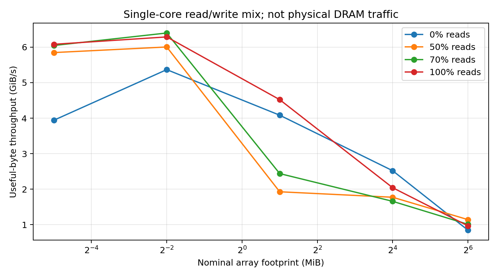
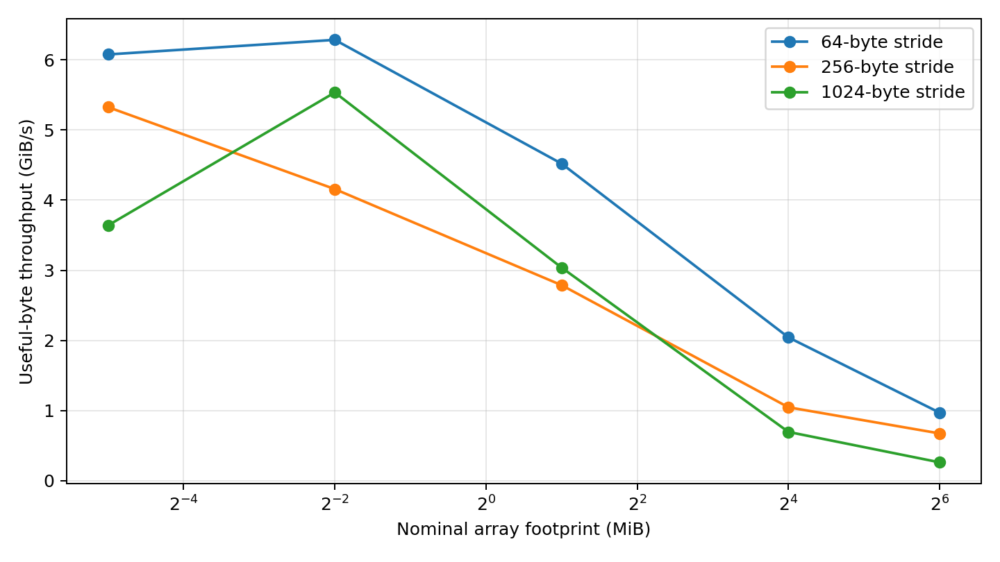
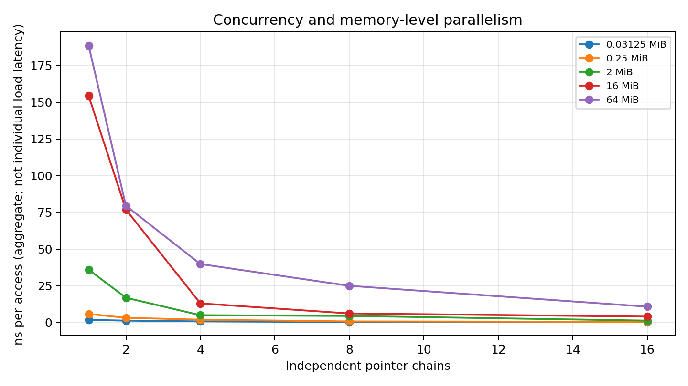

# Cache & Memory Performance Profiling

**ECSE 4320/6320 — Advanced Computer Systems | Project #2**

## Abstract

This study evaluated the effects of access dependencies, working-set size, spatial granularity, read/write mix, memory-level parallelism, and transparent huge-page advice using an instrumented single-process C benchmark. The available host was a virtualized Intel Xeon Platinum 8573C with a reported 48 KiB L1 data cache, 2 MiB private L2, and 260 MiB shared L3 cache. A three-repetition matrix produced 585 retained samples across 195 configurations. Random single-chain pointer-chase time increased from 2.53 ns/access for 32 KiB to 224.02 ns/access at 512 MiB. Eight independent pointer streams attained an aggregate 25.81 ns/access at 512 MiB, but this is *throughput per completed access*, not the intrinsic latency of an individual DRAM load. Because the environment does not provide `perf`, cache/TLB counter causality is not established.

## 1. System, implementation, and controls

GCC 14.2.0 compiled the program with `-O3`, C11, full warnings, and explicit `-fno-tree-vectorize -fno-lto`. The process uses `CLOCK_MONOTONIC_RAW`, page-aligned allocations, deterministic random permutations, input pre-touch and untimed warmup. All per-trial samples are preserved in timestamped CSV records. The CPU affinity visible to the environment was CPUs 0–4, but the process was not pinned; no frequency governor was exposed, SMT was reported disabled, and Linux perf was unavailable. These are not bare-metal cycle measurements. The Linux kernel identified itself as 6.18.55. The host reported a large shared cache; cache sharing and virtualization may influence apparent transitions.

The serialized latency kernel constructs a circular permutation of cache-line-separated indices; the next address depends on the previous load. It does not issue multiple independent outstanding reads. The multi-chain variant exposes 1, 2, 4, 8, or 16 independent chains in a single thread. The bandwidth kernel uses read-only, write-only, 70%/30%, or 50%/50% accesses with 64-, 256-, or 1024-byte spacing in linear or randomized order. A touched 8-byte value can transfer a larger physical cache line: the reported GiB/s is consequently **useful program bytes divided by elapsed time**, not verified DDR traffic.

## 2. Pre-experiment hypotheses

**Locality:** a serial random dependency chain is expected to plateau at low latency in the smallest cache and increase when its active footprint crosses L1, L2, LLC, then DRAM. Transition footprints are not guaranteed to equal published capacities because cache associativity, replacement, other clients, TLB overhead, and pointer/array metadata affect effective capacity.

**Access pattern:** linear traversal may be prefetched, while a uniformly permuted chain disrupts stride prediction and creates real dependencies. Larger physical stride should reduce useful-byte utilization of transferred cache lines, but a larger stride also decreases the count of active elements at fixed nominal allocation size.

**Concurrency and Little's Law:** one serial stream cannot provide much outstanding memory parallelism. Multiple independent streams should improve operations per second until the memory system or kernel overhead reaches a knee. For arrival/completion rate λ and average residence time W, the mean number of in-flight operations is L = λW. This equation does not permit inferring actual hardware MSHR occupancy without observing or independently estimating real memory residence time.

**AMAT:** a hierarchical model should approximate mean load latency, but miss rates and miss penalties cannot be fitted independently from timing-only observations. Page walks, queueing, inter-cache forwarding, and hardware prefetching are material confounders.

**Negative case:** the assumption that “64 MiB necessarily measures DRAM” should fail on a host reporting 260 MiB LLC. A direct comparison to 512 MiB should change the latency regime while still not proving every access reached DRAM.

## 3. Observed locality transitions

| Nominal footprint | Random serial latency (ns/access) | Interpretation |
| --- | ---: | --- |
| 32 KiB | 2.53 | Fits in reported 48 KiB L1D nominal capacity |
| 256 KiB | 6.65 | Exceeds L1; plausibly L2-resident |
| 2 MiB | 30.06 | L2 capacity boundary; replacement, TLB, and shared-cache behavior may contribute |
| 16 MiB | 160.55 | L3-capable footprint, but effective latency far exceeds naive L3-hit expectations |
| 64 MiB | 166.10 | Below reported LLC capacity; cannot label DRAM-only |
| 512 MiB | 224.02 | Exceeds LLC capacity; DRAM misses expected, but not directly counter-verified |

The step between 2 MiB and 16 MiB is larger than a simple idealized cache hierarchy might predict. Two falsifiable mechanisms are (1) greater page-walk/TLB pressure from random cache-line accesses and (2) cache sharing or virtualized scheduling interference. Controlled hardware PMU events for dTLB loads, LLC load misses, and CPU migrations would separate the hypotheses; those events were not accessible in this environment. The randomized chain and sequential chain should not be equated with cold-cache compulsory miss tests, because the initial warmup and repetitions explicitly enable cache reuse.

## 4. Read/write mix and spatial-granularity sensitivity

| Footprint | 100% read | 70% read / 30% write | 50% read / 50% write | 100% write |
| --- | ---: | ---: | ---: | ---: |
| 256 KiB | 6.29 | 6.40 | 6.00 | 5.37 |
| 2 MiB | 4.52 | 2.44 | 1.93 | 4.08 |
| 16 MiB | 2.04 | 1.66 | 1.77 | 2.52 |
| 64 MiB | 0.97 | 1.01 | 1.14 | 0.85 |

Values are **median useful GiB/s**, not actual memory-controller bandwidth; the experiments use 64-byte stride and linear order. The read/write split is an **operation ratio**, not byte-accurate DRAM transaction accounting. Mixed operations contain a conditional branch per access and may incur dirty writeback or write-allocate effects. A 70/30 versus 50/50 reversal in the 64 MiB case is an observed non-monotonic result, not evidence of a universally optimal ratio. Hypothesis A: branch execution and store-buffer occupancy differ. Hypothesis B: virtual CPU migration, background interference, or dirty-cache state differs. Independent reruns with randomized ordering, pinned execution and PMU traffic events would distinguish the mechanisms.

The stride sweep shows useful-throughput sensitivity to 64-, 256-, and 1024-byte spacing under fixed nominal allocation. Crucially, a larger stride **decreases the visited node count** for fixed bytes, so this is a combined test of spatial efficiency and number of operations; no strict causal claim about stride alone is made. Random-order index arrays additionally consume cache/TLB space, which must be included when interpreting the footprint.

## 5. Independent-chain concurrency and Little's Law

At 64 MiB and 64-byte random stride, the observed medians were:

| Independent chains | Aggregate ns/access | Useful GiB/s |
| ---: | ---: | ---: |
| 1 | 188.48 | 0.040 |
| 2 | 79.54 | 0.094 |
| 4 | 39.84 | 0.187 |
| 8 | 25.02 | 0.298 |
| 16 | 10.83 | 0.688 |

The 16-chain configuration completed accesses at approximately 17.4 times the rate of the one-chain configuration, although the comparisons represent concurrent work sharing the same core and backing chain rather than independently isolated DRAM channels. The aggregate time per completed access shrinks as operations overlap; individual load service latency need not change. At 512 MiB, one serial chain measured 224.02 ns/access, while eight chains measured 25.81 aggregate ns/access (a roughly 8.7-fold operation-rate improvement).

For an illustrative Little's Law calculation, eight-stream 512 MiB execution has a completion rate of approximately 1/(25.81 ns) = 38.7 million operations/s. If **one assumed** a 224.02 ns average residence per outstanding access, L ≈ 38.7e6/s × 224.02e-9s ≈ 8.7 in-flight accesses. This is a consistency calculation based on a strong assumption, **not a measured MSHR count**; in particular, concurrent accesses may change residency, hit fractions and latency. The observed curve does not conclusively identify a saturation knee before 16 chains: no plateau should be invented.

## 6. AMAT model and limits

A basic three-level model is:

`AMAT = t_L1 + m_L1 × (t_L2 + m_L2 × (t_L3 + m_L3 × t_DRAM))`.

Here `t` represents incremental hit-service cost at the relevant level and `m` the conditional miss probability. If page translation is not always overlapped, an additional expected translation term is needed. For a single dependent load, total elapsed time further includes loop and dependency overhead; concurrency modifies queueing and perceived throughput. Because no PMU events were accessible, the experiment **does not fit numerical miss rates or memory penalties** from timing alone. Likewise, deriving both a probability and penalty from the same latency measurements would be underdetermined and would create unjustified precision.

The program records a 4096-byte stride and compares `MADV_HUGEPAGE` requested versus unrequested. At 64 MiB the observed randomized dependent-load medians were 78.39 versus 68.84 ns/access, respectively. This **does not prove that huge pages were allocated**: `madvise` expresses a request and kernel policy, not a physical page-size guarantee. To establish translation causality would require checking actual page backing (`smaps` or equivalent) and measuring dTLB walk/miss events under permission to collect counters.

## 7. Negative/failure-case analysis

The first tempting but erroneous conclusion is “64 MiB is much larger than L2, so its 166.10 ns latency measures DRAM.” This is unsupported on the present platform because the reported LLC is **260 MiB**. The completed beyond-LLC test instead allocated 512 MiB and observed **224.02 ns/access**. The increase is consistent with DRAM participation but not a direct physical-traffic measurement. Alternatives include NUMA placement, changes in shared-cache occupancy, TLB/page-walk pressure, or VM scheduling. A decisive comparison would pair hardware LLC misses, memory-controller bytes, and page-walk counters with pinned, repeated 64/128/256/512/1024 MiB sweeps.

A second failure case is interpreting 8-byte useful-throughput as real DRAM bandwidth. A 64-byte cache line can be fetched or written back to serve one 8-byte operation; cold stores may trigger a read-for-ownership. A truthful physical read/write bandwidth estimate requires PMU memory-controller counters or a validated bandwidth instrument such as Intel Memory Latency Checker or STREAM in a controlled regime. The environment had no executable `perf` and no MLC, so these quantities are explicitly **unavailable**, rather than silently treated as zero.

## 8. Limitations, anomalies, and conclusion

The measurement campaign retained 585 timing samples across 195 configurations. The primary locality and mix cases had three repeated samples each; plots show error bars where plotted. The sandbox restricts affinity control, frequency governance, hardware-counter access, and huge-page verification. The kernels have a bounded 32-bit index space and the random-throughput condition maintains a separate index permutation, so random metadata overhead is real. In multi-chain tests each independent cursor traverses the same logical cycle from separated offsets; this isolates outstanding dependency chains but not distinct physical channel assignments. Cache-sweep transition points, the apparent 2 MiB-to-16 MiB jump, and the mixed-ratio reversals must therefore be interpreted cautiously.

The most defensible result is the consistent architectural distinction between serialized memory-access latency and attainable throughput with multiple independent accesses, combined with the negative finding that nominal footprint and useful program bytes do not establish actual DRAM behavior. The generated figures and raw records support those statements; actual cache misses, TLB misses, memory-controller bandwidth, confirmed large-page backing, and queue occupancy remain unmeasured.

## AI-use and validation statement

ChatGPT assisted with the C benchmark, shell runners, Python analysis, plotting, and report writing. The code was compiled with GCC, tested over 105 representative configurations, run in the available Xeon virtualized environment, and used to generate actual CSV tables and figures. Counter values, privileged configurations, and other-machine results were not fabricated. Any subsequent independent replication must preserve the hardware/software conditions as part of its own evidence.
