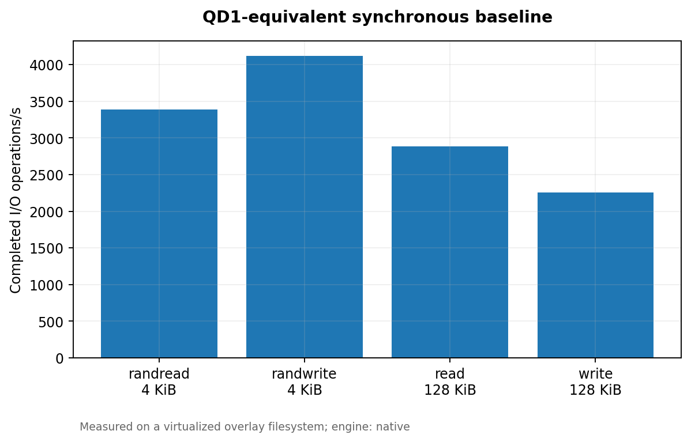
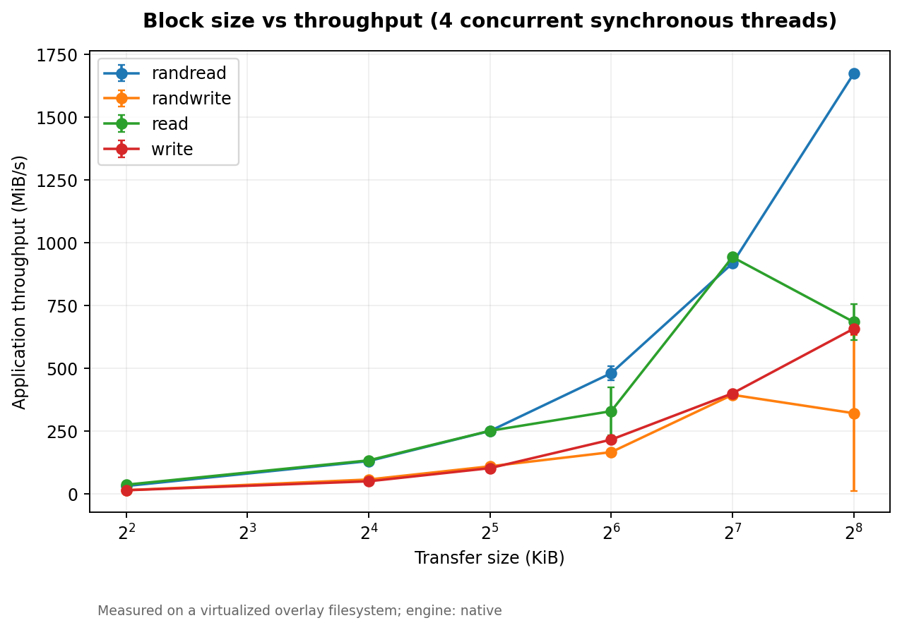
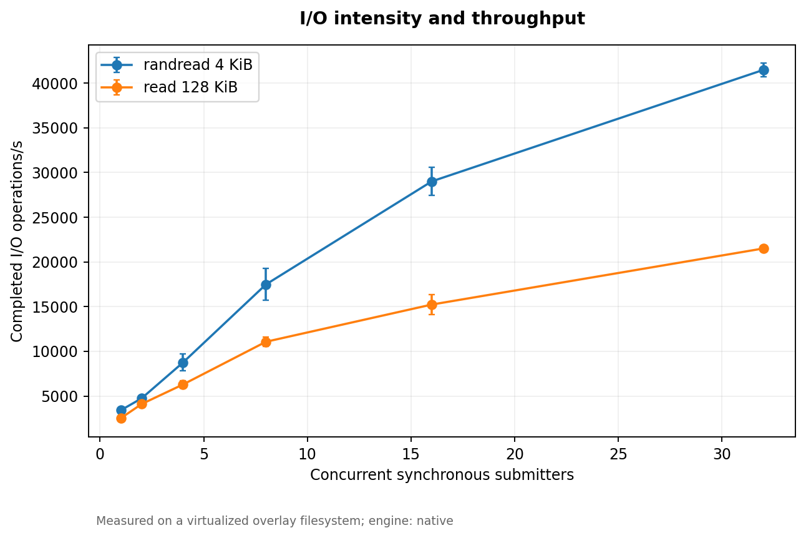
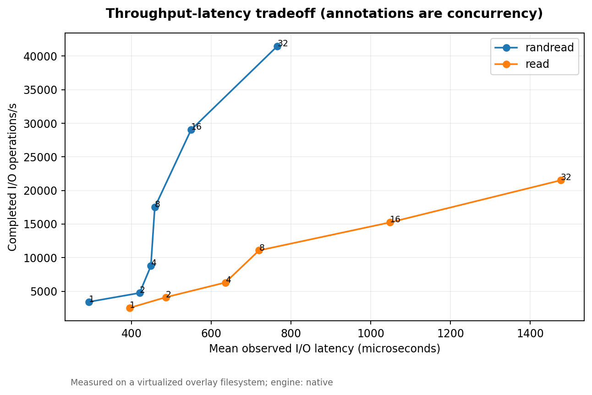
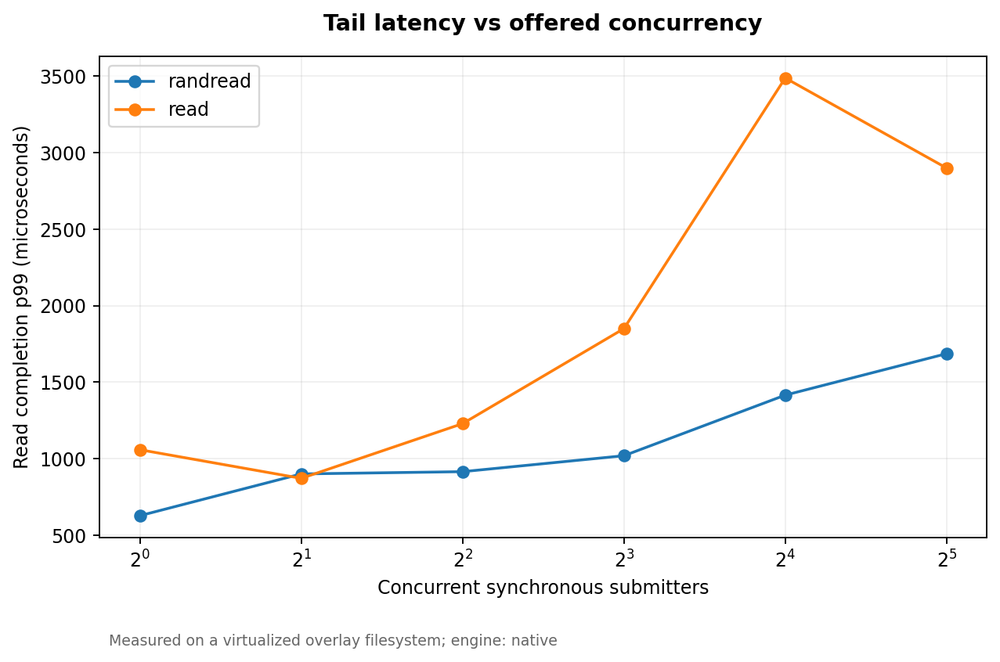
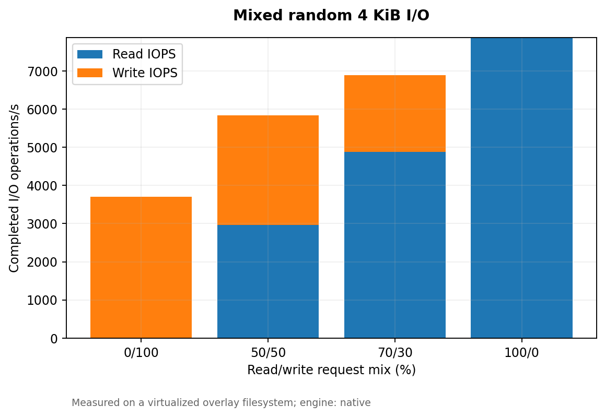
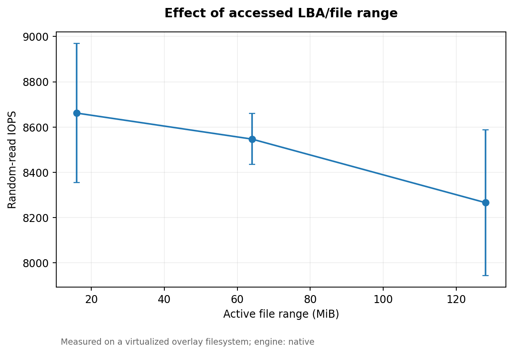
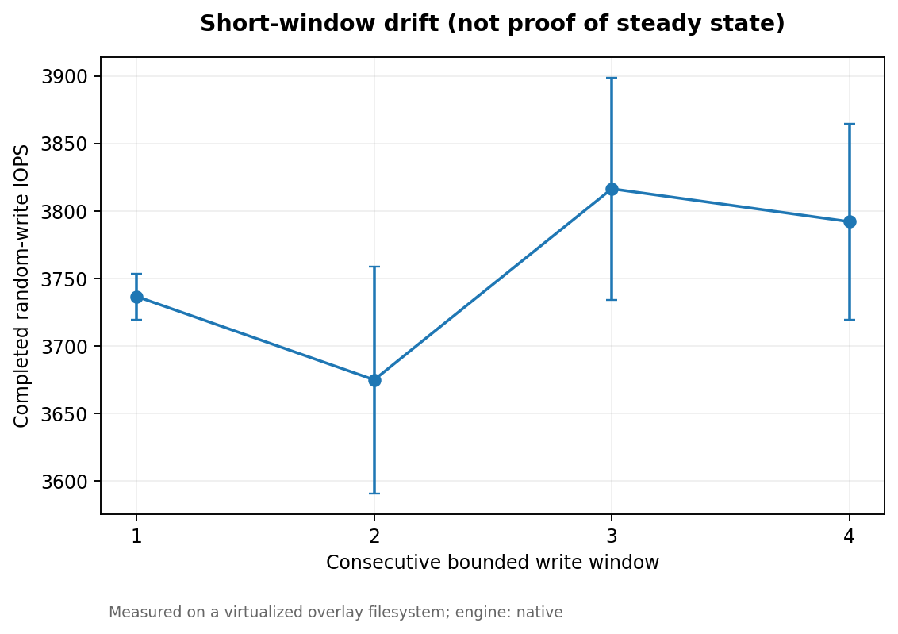

# SSD Performance Profiling — Experimental Report

**ECSE 4320/6320 | Advanced Computer Systems | Class-wide Project 3**

**Measurement environment:** virtualized Intel Xeon Platinum 8573C with overlayfs-backed disposable file; 128 MiB preinitialized file, Linux synchronous POSIX `pread`/`pwrite`, `O_DIRECT=1` unless specified. **These are measured file-I/O stack observations, not verified results from an identifiable SSD.** The Flexible I/O Tester binary was unavailable; this repository includes guarded, runnable fio configurations but contains **zero fio-generated performance records**. The local `fio` executable belongs to the unrelated Fiona Python package.

## Executive summary

The recorded experiment contains **118 completed samples across 59 workload configurations**, with two independent runs per configuration. Four one-worker baseline patterns, 24 size/pattern combinations, read/write mixtures, concurrent submitter sweeps, LBA range, short-window writes, tail-latency comparisons, and a buffered-I/O negative control were evaluated. Nine plots and direction-specific p50/p95/p99/p99.9 measures were generated. The clearest methodological failure was 4,070.2 MiB/s for buffered sequential 128 KiB reads versus 345.1 MiB/s for direct reads (11.79x). The first path can exploit page cache and therefore must not be labeled SSD bandwidth.

## 1. Pre-experiment hypotheses

1. **QD1 baseline:** serialized 4 KiB random reads/writes should have low bandwidth compared with 128 KiB transfers, because each operation incurs fixed request-processing overhead. A single synchronous worker has approximately one outstanding request.
2. **Size and pattern:** small random requests should be limited by per-request overhead and IOPS; large sequential transfers should amortize this overhead and increase MiB/s until another bottleneck dominates. Monotonicity is not guaranteed under contention.
3. **Read/write ratio:** increasing writes should alter throughput and tail latency because allocation, device staging, writeback, filesystem metadata and interference differ from read paths. The actual I/O mix is stochastic in the native generator.
4. **Concurrency and queueing:** additional independent synchronous workers should initially increase throughput while increasing mean and tail latency after storage-path contention develops. These workers must not be misrepresented as fio asynchronous queue depth.
5. **Tail distribution:** p95, p99 and p99.9 can grow much faster than the median when the storage path experiences shared-host scheduling, writeback or burst throttling.
6. **Working-set and device state:** smaller active ranges may benefit from caching below the application page cache; short write windows may change as buffers, mapping tables and queues evolve. Four short windows do not constitute steady-state SSD preconditioning.
7. **Failure hypothesis:** a buffered sequential-read benchmark can report RAM/page-cache throughput instead of storage latency. With `O_DIRECT`, the result should differ significantly if page-cache reuse was distorting the comparison.

## 2. Experimental design and measurement discipline

The implementation initializes a new 128 MiB, permission-restricted regular file in `data/scratch` and deletes only that uniquely named file after measurement. It never opens a raw disk/partition. The file is filled before timing with a nonzero 1 MiB pseudorandom data block repeated across the file, then synchronized; deduplication below the filesystem remains possible. Test requests are aligned to 4,096 bytes, and the native C harness requires exact full-length `pread` or `pwrite` completion. The runner rejects non-Flexible-I/O-Tester executables. The captured filesystem is overlayfs, and no physical SSD identity or NVMe device temperature is available.

All samples are measured with `CLOCK_MONOTONIC` around synchronous system calls. Each thread issues at most one blocking transfer. The offered-concurrency sweep of 1, 2, 4, 8, 16 and 32 threads tests aggregate in-flight operations, **not** an asynchronous FIO `iodepth=1..32` sweep. The independent run containing the first 25 cases used 600 ms per configuration; the follow-up run containing the remaining 34 cases used 400 ms. Every configuration has two repetitions, and the stored summary is the median of run-level estimates with sample standard deviation. Run-level latency percentiles are aggregated by median; they are not pooled percentiles across raw I/Os from different repetitions. The short windows are sufficient for a controlled exploratory comparison, not for a steady-state SSD certification.

`fio` scripts supplied in the package use `ioengine=libaio`, direct I/O, one job, explicit requested `iodepth`, a bounded regular scratch file, `group_reporting`, latency percentiles, block-size and workload parameters. This environment did not execute those scripts because the genuine tool was absent. The reported statistics are from the separately labeled native POSIX engine. CPU affinity, device SMART telemetry, drive temperature, erase counts and actual controller queue depth were not measured; there is no basis to imply otherwise.

## 3. Single-outstanding-I/O baselines

| Pattern | Transfer KiB | IOPS | MiB/s | Mean latency µs | Direction p99 µs |
|---|---:|---:|---:|---:|---:|
| randread | 4 | 3,384 | 13.2 | 295.1 | 719.7 |
| randwrite | 4 | 4,115 | 16.1 | 246.2 | 809.7 |
| read | 128 | 2,889 | 361.1 | 345.7 | 646.0 |
| write | 128 | 2,258 | 282.3 | 519.1 | 1,552.7 |

The 128 KiB transfer carries 32 times as many application bytes as the 4 KiB transfer. Accordingly, sequential throughput can rise even when the number of I/O operations per second falls. The bandwidth values are application byte counts divided by elapsed time, not PCIe throughput or measured flash-channel traffic. Median/tail measurements are preserved separately for reads and writes in `data/processed/summary.csv`.

## 4. Block-size and access-pattern sweep

For each of 4, 16, 32, 64, 128 and 256 KiB, random read, random write, sequential read and sequential write modes were measured with four synchronous submitters. The 4 KiB random-read workload produced 31.4 MiB/s, whereas 256 KiB random reads produced 1,671.9 MiB/s. This increase mostly reflects larger transfer granularity: total IOPS need not rise. Anomalous non-monotone points cannot be attributed uniquely to flash behavior on a shared virtual filesystem.

## 5. Concurrency, throughput–latency and Little's Law

| Synchronous workers | Random read 4 KiB IOPS | Mean latency µs | Read p99 µs | λW (requests) |
|---:|---:|---:|---:|---:|
| 1 | 3,412 | 292.7 | 628.8 | 1.00 |
| 16 | 29,015 | 549.3 | 1,415.8 | 15.91 |
| 32 | 41,486 | 765.9 | 1,686.3 | 31.77 |

Little's Law in stable operation is **L = λW**, where L is average outstanding work, λ is completed I/O/s, and W is end-to-end I/O response time in seconds. For 32 synchronous workers, λW = 41,486.0 × 0.0007659 ≈ **31.77**. One worker yields ≈ 1.00. This is an internal consistency check of a fixed-worker, blocking I/O loop, not proof of the hardware controller's queue depth. The 32-worker throughput is 12.16x the one-worker throughput while mean latency grows from 292.7 to 765.9 µs. Measured throughput continued growing up to 32 workers, so a definitive saturation knee was **not observed** within the supported range. A knee should not be invented by extrapolation.

## 6. Tail latency under load

The 4 KiB random-read p99 rose from 628.8 µs at one worker to 1,686.3 µs at 32 workers. Read p99.9 rose from 1,476.1 to 3,582.6 µs. For 4 KiB random writes, the dedicated 4-worker negative-load case showed p99 8,656.4 µs, compared with p99 13,693.4 µs for 16 workers, while write throughput did not scale proportionally. This suggests contention or host throttling but does not establish whether the limiting component is the device, filesystem, hypervisor or shared tenant activity.

A p99.9 computed from a few thousand observations is intrinsically noisy; the raw per-run distributions and run counts have therefore been preserved. No synthetic tail latency, 99.99th percentile or undocumented warm-state claim was inserted.

## 7. Read/write mixture

| Target read/write (%) | Read IOPS | Write IOPS | Total IOPS | Total MiB/s |
|---|---:|---:|---:|---:|
| 100/0 | 7,874 | 0 | 7,874 | 30.8 |
| 70/30 | 4,879 | 2,010 | 6,889 | 26.9 |
| 50/50 | 2,968 | 2,863 | 5,831 | 22.8 |
| 0/100 | 0 | 3,708 | 3,708 | 14.5 |

The reported throughput is completed I/O, not the requested mixture label converted into fictitious rates. Both read and write latency distributions are retained separately. The 50/50 mode showed 5,831 total IOPS, while the read-only mode showed 7,874 total IOPS. Interference between directions and the virtualized storage backend are plausible causes, not verified controller-level mechanisms.

## 8. Accessed range and short-window state

Random 4 KiB read throughput changed from 8,662 IOPS for a 16 MiB file range to 8,266 IOPS across 128 MiB. The difference is modest relative to the large disparity between buffered and direct I/O in the negative control. With `O_DIRECT`, software page-cache effects should be reduced, but backend caches and virtualization remain possible.

The four consecutive short random-write phases measured window 1: 3,737 IOPS, window 2: 3,675 IOPS, window 3: 3,816 IOPS, window 4: 3,792 IOPS. There is no progressive reduction large enough here to establish SLC exhaustion or thermal throttling. The work file, virtual disk sharing, short duration and lack of SMART measurements prevent steady-state or endurance claims.

## 9. Verified negative case: buffered sequential reads

Under otherwise matched 128 KiB single-worker sequential reads, buffered I/O produced **4,070.2 MiB/s**, compared with **345.1 MiB/s** under `O_DIRECT=1`. The **11.79x** difference is evidence that caching or a different software I/O path materially affects benchmark results. Treating the buffered number as SSD sequential throughput would therefore be misleading. The 4 KiB random-read negative control did not show the same benefit: buffered 3,240 IOPS, direct 3,803 IOPS. This distinction avoids a blanket claim that buffered I/O always appears faster.

Two falsifiable explanations exist. **(i)** Cached file pages and sequential readahead satisfy many buffered calls without storage access. **(ii)** Linux overlayfs or hypervisor storage implementation follows differing copy and mapping paths for the two modes even without ordinary page-cache hits. Page-cache hit/miss instrumentation or `mincore`/cache-drop experiments on a dedicated system could separate these mechanisms; a direct device/host trace could further resolve them. Neither counter set was available here. These are competing explanations, not proven diagnoses.

## 10. Limitations, anomaly containment, and sources

**Storage identity:** the measured file resides on overlayfs over virtualized storage; an SSD model, firmware, physical interface, controller counters and SMART temperature are unavailable. Numerical values cannot be generalized to physical NVMe SSD performance. **Queue depth:** native concurrency was implemented with blocking independent threads, not libaio or io_uring; requested fio depth is defined in scripts but not validated with fio counters here. **Steady state:** 400–600 ms trials, no long conditioning phase, and four short write windows do not establish burst-to-steady-state behavior. **Workload effects:** one 128 MiB file and repeated pseudorandom initialization can interact with deduplication and backend caches. **Quantiles:** p99.9 is sensitive to sample count and outliers. **Isolation:** no host-level CPU or device isolation was granted. Two interrupted collection sessions were recovered without manufacturing missing records; all included configurations have two successful measurements. **Transfer semantics:** `O_DIRECT` succeeding on overlayfs is evidence of an accepted request flag, not independent proof of physical media traffic.

**Source basis:** course project description, pages 6–7, *ECSE 4320/6320 Advanced Computer Systems: Class-wide Projects*; official fio documentation at https://fio.readthedocs.io/en/master/fio_doc.html; original raw run JSON and `evidence/environment.txt` packaged here. No external hardware measurements were imported.

**AI-use declaration:** OpenAI ChatGPT assisted in writing and debugging the C benchmark, guarded FIO runner, parsing and plotting scripts, the technical prose and the report layout. The native program was compiled and exercised; automated tests passed and all numerical findings came from the saved raw observations. The fio execution path was written and parser-tested against an explicit synthetic schema example, but real fio I/O did not run on this machine. No SSD model, PMU/SMART telemetry, verified asynchronous queue depth, or steady-state values were fabricated.
